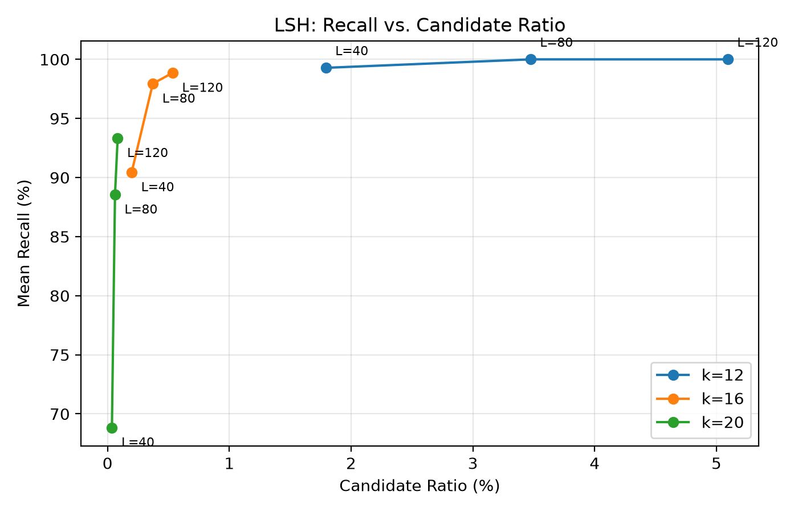
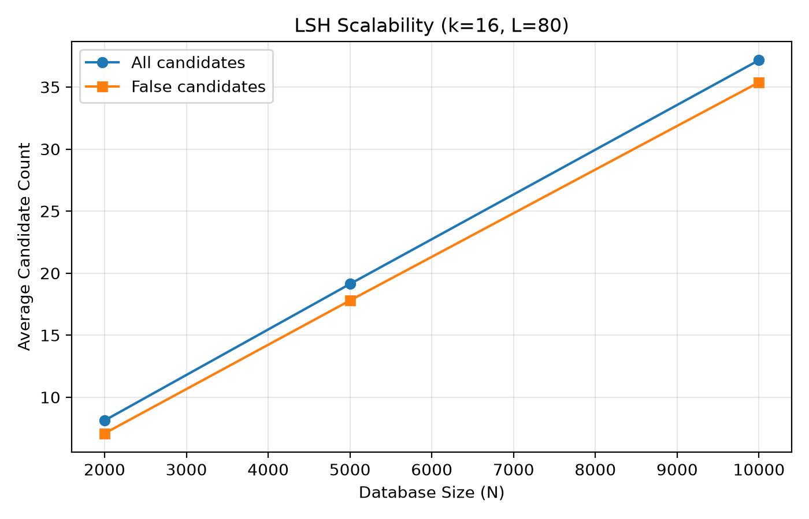

\begin{center}
{\Large\bfseries 基于哈希的语义复用系统设计与实验}

\vspace{5pt}
{\small 姓名：吴柯蝶 \quad 学号：24302010063}

\vspace{3pt}
{\small GitHub：\href{https://github.com/koko-dodo/hash-semantic-reuse}{github.com/koko-dodo/hash-semantic-reuse}}\end{center}
\vspace{-5pt}

## 1. 实验背景与问题定义

历史请求的检索与结果复用可以减少大语言模型的重复推理。暴力语义检索需要与全部历史向量计算相似度；本实验先用 Exact Hash 识别相同文本，未命中时用 Random Hyperplane LSH 生成候选，再做余弦验证，研究 Recall、Candidate Size、查询时间和索引空间之间的权衡。

## 2. 数据集与实验设置

### 2.1 数据集构造

采用 Quora Question Pairs：共 404,290 对英文问题，其中 149,263 对标注为重复。清洗、去重并固定随机种子后，构造 10,000 条 Historical Prompts 和 200 条 Test Queries。每条 Query 来自重复问题对，另一条问题放入历史库；两集合各自文本唯一，且无完全相同的字符串。

### 2.2 Embedding 与 Ground Truth

使用 `sentence-transformers/all-MiniLM-L6-v2` 生成 384 维向量并做 L2 归一化，统一阈值 $\tau=0.8$。对每条查询遍历全部历史向量得到：

$$
G(q)=\{p\in P\mid\cos(q,p)\geq0.8\}.
$$

200 条查询中，173 条 Ground Truth 非空、27 条为空。人工 Duplicate Label 用于构造查询，不等于 Embedding 与余弦阈值定义的 Ground Truth。

### 2.3 评价指标

令 $R(q)$ 为最终返回集、$C(q)$ 为去重候选集、$N$ 为历史库大小：

$$
\mathrm{Recall}(q)=\frac{|R(q)\cap G(q)|}{|G(q)|},\qquad
\mathrm{Candidate\ Ratio}(q)=\frac{|C(q)|}{N}.
$$

**Macro Recall** 只对 $G(q)\ne\varnothing$ 的查询取平均；候选数与候选比例对全部查询统计。**Query Cost** 同时报告实际延迟和最终余弦验证次数，后者不包括 LSH 投影。**Memory Cost** 区分历史 Embedding 与额外索引内存。

## 3. 基于哈希的检索算法设计

### 3.1 Exact Hash：精确匹配

用 Python Dictionary 建立“历史文本 → Prompt ID”索引，命中即返回可复用结果。忽略字符串哈希成本时，平均查找为 $O(1)$；实际哈希成本与文本长度有关。普通哈希尽量区分不同元素，而 LSH 有意提高相似向量的碰撞概率。

### 3.2 Random Hyperplane LSH：语义候选生成

对 $d$ 维向量 $x$，独立采样标准高斯法向量 $r\in\mathbb R^d$，以投影符号生成 bit：

$$
h_r(x)=\begin{cases}1,&r\cdot x\geq0,\\0,&r\cdot x<0.\end{cases}
\qquad p(s)=1-\frac{\theta}{\pi}=1-\frac{\arccos(s)}{\pi}.
$$

将 $k$ 个独立 bit 组成 Hash Key，建立 $L$ 张独立表。单表碰撞概率为 $p(s)^k$，至少一表碰撞的概率为：

$$
P(s)=1-\bigl(1-p(s)^k\bigr)^L.
$$

查询时合并并去重各表对应桶的 ID，只对候选进行最终余弦验证。

\newpage

### 3.3 参数 $k$、$L$、$\tau$ 的选择依据

$\tau=0.8$ 是统一实验标准，并非人工标注验证的最优阈值；提高阈值会缩小接受集合。增大 $k$ 使筛选更严格，通常减少候选但损失 Recall；增大 $L$ 增加碰撞机会，同时增加候选、投影和存储成本。

当 $s=0.8,k=16$ 时，$L=80$、120 的理论碰撞概率分别约 87.39%、95.52%，针对单个边界向量对，并非整体 Recall。实验比较 $k\in\{12,16,20\}$、$L\in\{40,80,120\}$ 的九种组合；重点配置 $k=16,L=80$ 偏重降低候选验证成本，并非所有指标的全局最优。相比 $L=120$，它以一定召回损失换取更少候选和更低索引开销。

### 3.4 核心检索算法

**Algorithm 1：Hash-based Semantic Reuse**

```text
Input: text q, exact index H, L LSH tables, model f, threshold tau
1. id <- H.lookup(q)
2. if id exists: return EXACT_MATCH(id)
3. v <- Normalize(f(q)); C <- empty set
4. for i = 1 to L:
       C <- C union Table[i][LSH_Hash(v, i)]
5. R <- empty set
6. for id in C:
       if Cosine(v, Embedding[id]) >= tau: R <- R union {id}
7. if R is empty: return NO_MATCH
8. return SEMANTIC_MATCH(R)
```

Exact 命中返回单个复用结果，不代表全部阈值近邻；未命中才生成 Embedding 并执行 LSH。Semantic 路径返回候选中全部通过阈值的近邻；预计算 Query Embedding 可直接用于测试。

### 3.5 复杂度分析

设桶访问条目总数为 $B$、候选数为 $|C|$。不计 Embedding 推理，LSH 的 $Lk$ 次投影为 $O(Lkd)$，加上桶访问和验证后为：

$$
T_{\mathrm{LSH}}=O(Lkd+B+|C|d),\qquad T_{\mathrm{brute}}=O(Nd).
$$

历史 Embedding、超平面、桶条目分别占 $O(Nd)$、$O(Lkd)$、$O(LN)$ 空间。LSH 以额外空间和哈希计算换取 $|C|\ll N$，不保证实际时延更短。

## 4. 实验结果与性能分析

### 4.1 参数敏感性分析

固定 $\tau=0.8$：增大 $k$ 减少候选但降低 Recall，增大 $L$ 则提高召回并增加查询成本。例如 $L=80$ 时，$k$ 从 12 增至 20，Candidate Ratio 从 3.473% 降至 0.061%，Macro Recall 从 100% 降至 88.55%。重点配置 $k=16,L=80$ 达到 97.94% Macro Recall、0.37165% Candidate Ratio，平均验证 37.165 个历史向量。

{width=11cm}

\newpage

### 4.2 三种方法的性能比较

在 $N=10000$、200 条语义查询上统一预热并重复计时五轮。文本与向量预加载，排除模型加载、Embedding 生成与索引构建；Hash + LSH 包含 Exact 查询、未命中后的候选生成和余弦验证。

| 方法 | Macro Recall | Candidate Ratio | 平均延迟 |
|---|---:|---:|---:|
| Brute-force | 100% | 100% | 75.889 μs |
| Exact Hash Only | 0% | 0% | 0.229 μs |
| Hash + LSH | 97.94% | 0.37165% | 390.469 μs |

语义查询与历史文本无重合，因此 Exact Hash Only 的 Recall 为 0%。额外 100 条已知 Exact Match 均由统一检索器正确命中，跳过 Embedding 和 LSH，平均耗时约 0.802 μs；这是精确复用准确率，不能混作语义 Recall。

Hash + LSH 将最终余弦验证从 10,000 次降至平均 37.165 次，减少约 99.63%，但延迟约为暴力搜索的 5.15 倍。Python 多次投影、多表查找和集合操作的开销，高于 NumPy 优化的全库矩阵运算；减少候选不必然带来时延优势。

### 4.3 内存开销分析

历史 Embedding 数据缓冲区约 14.65 MiB；$k=16,L=80$ 的索引 traced allocation 约 121.89 MiB，$L=120$ 时为 182.79 MiB。该统计是构建后可追踪的存活分配增量，包含超平面，不能再次叠加其字节数；不包含追踪开始前加载的历史 Embedding，也不等于进程 RSS。

超平面和桶条目的理论开销分别为 $O(Lkd)$、$O(LN)$；实际 Python 字典、列表、整数及预留容量还会增加内存。LSH 缩小候选范围需要额外索引，不能同时保证更低存储和时延。

## 5. 数据规模扩展与算法讨论

### 5.1 数据规模对检索性能的影响

固定 $k=16,L=80$，使用嵌套历史库前缀，并对各 $N$ 重新计算 Ground Truth：

| N | Macro Recall | 平均候选数 | 平均无关候选数 |
|---:|---:|---:|---:|
| 2,000 | 98.42% | 8.125 | 7.085 |
| 5,000 | 98.57% | 19.125 | 17.795 |
| 10,000 | 97.94% | 37.165 | 35.380 |

\newpage

{width=11.5cm}

候选及无关候选随 $N$ 增长，Candidate Ratio 约为 0.4%。令无关历史元素 $i$ 进入候选集的概率为 $P_i$，则：

$$
\mathbb E[|C(q)\setminus G(q)|]=\sum_{i\notin G(q)}P_i
\approx(N-|G(q)|)p_{\mathrm{false}}.
$$

后一步假设无关元素碰撞概率近似相同。近邻较少、相似度分布稳定时，无关候选期望近似随 $N$ 线性增长；较低的单点碰撞概率仍会累积成可观的验证开销。

### 5.2 大规模场景下的改进思路

小规模上的参数未必适合更大的数据库。随 $N$ 提高 $k$ 可减少 False Candidates，但可能损失 Recall；可增加 $L$ 补偿，代价是更多投影与内存。Multi-probe LSH 可在较少表中探查邻近桶，或对高密度桶二级划分，以权衡 Recall 与 Memory Cost。应先明确目标 Recall，再联合优化候选比例、查询时间和内存；这些方向尚未实测。

### 5.3 实验局限与结论

Ground Truth 依赖固定模型和阈值，Duplicate Pair 查询不能代表完整线上分布。Scalability 前缀保留固定配对记录，各规模有效查询集合也可能变化，因此不能把 Recall 小幅变化全归因于 $N$，或将趋势推广到任意分布。当前结果证明哈希能有效缩小搜索范围，同时呈现召回、实际计算和内存之间的权衡，而非证明 LSH 总比暴力检索更快。

## 6. 最后思考

现代 AI 语义检索仍是算法设计问题：Embedding 解决语义表示，不直接解决搜索；逐一比较 $N$ 个 $d$ 维向量仍需 $O(Nd)$。Hash 的价值在于改变搜索空间，优先检查更可能相似的历史请求。LSH 利用概率碰撞，以额外空间和投影换取候选缩减；真正的收益必须同时由 Recall、Candidate Ratio、实际延迟和存储成本检验。

<!-- 从仓库根目录导出：pandoc report/report.md --from=markdown --pdf-engine=xelatex --resource-path=report --output=report/report.pdf -->
